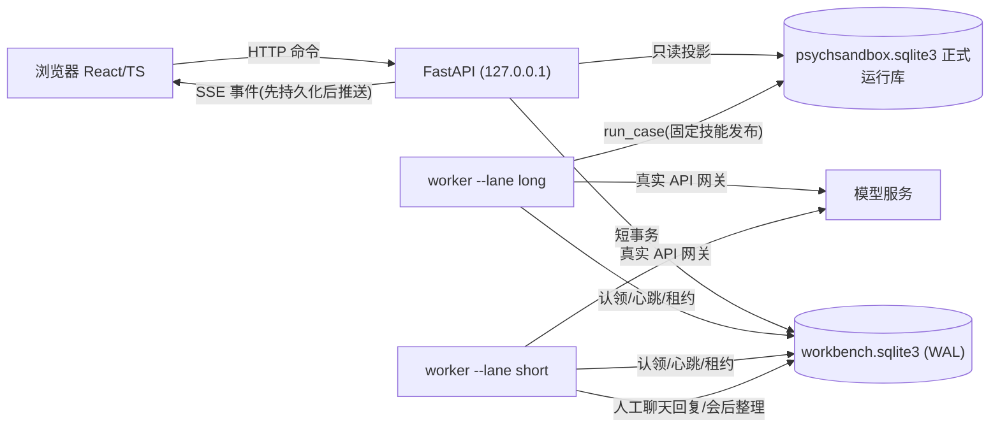
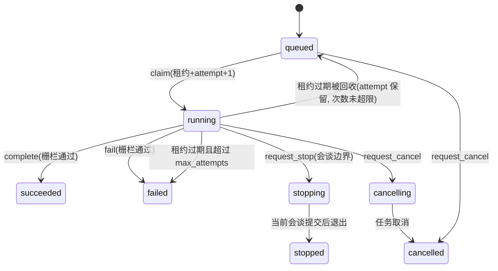
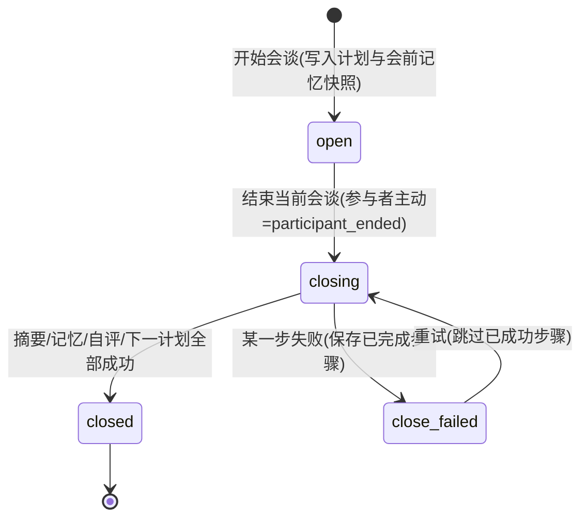

# 科研 Web 工作台设计（design.md）

本文是工作台的架构、领域契约、状态机与关键决策记录，也是中断后恢复的依据。
标记约定：**[事实]** 已在代码/测试中核实；**[决策]** 本次设计选择；**[假设]** 尚待真实运行验证。

## 0. 现状核查（P0，2026-10-26）

- [事实] 仓库为 Python 包 `psychsandbox`（`src/`），CLI `psych-sandbox`；无既有 Web 基础，因此采用 FastAPI + React/TS/Vite。
- [事实] 基线 `pytest -q`：532 通过、1 失败。失败用例 `tests/test_launcher_script.py::test_launcher_enables_logprob_scoring_by_default`，原因是工作区中**用户未提交**的 `run_simulate.bat` 修改（`LOGPROB_SCORING=0`、`PROBE_LOGPROB=0`）。本项目不改动该文件，视为预先存在的失败。
- [事实] 正式运行库 `runs/runtime/psychsandbox.sqlite3`（`SQLiteStore`），表含 `experiment_runs/sessions/turns/memories/trajectories/holistic_evaluations/rollout_batches/rollout_candidates/skills/skill_versions`。`RunManager` 只删除运行相关表，保留 `cases/skills/skill_versions`。
- [事实] `run_case` 进程内互斥（`single_simulation`），续跑用 OS 文件锁（`available_run_dir`）并尊重删除日志。
- [事实] `SessionRecord` 无逐场评估字段；RFT 候选评分保存在 `RolloutCandidateSummary.assessment`；整体督导只在轨迹结束后执行一次。
- [事实] 旧 `SkillEvolutionManager` 仅做状态转移，`review_note` 字符串即可通过；`ExperiencePool` 只是 JSONL；`training/export.py` 的 DPO 用两条轨迹末句配对——三者都不满足需求，需要扩展。
- [事实] `LongitudinalEvaluator` 依赖模拟 `ClientState` 增量；`MemoryConsolidator`、`validated_review`、`CounselorAgent.review_session` 只读取会谈的 `plan/messages/decisions/summary/clinical_summary/turn_records/risk_events/safety_verdict/interventions_used/end_reason`（鸭子类型），不需要模拟状态。
- [事实] 参考项目 `PsychAgent-main/src/web` 为 React JSX 的“侧栏 + 时间线 + 右侧面板 + 聊天输入”组织。本项目只参考此布局思路，未复制源码或资产。

## 1. 总体架构

- [决策] 新增独立库 `runs/runtime/workbench.sqlite3` 保存任务、事件、人工疗程、技能发布与演化、导出审计。不改正式运行库表结构，`RunManager` 的删除语义不受影响；正式共享技能版本不在运行表中，删除运行不会删除它们。
- [决策] 浏览器不持有任何模型密钥；密钥只由 worker 进程从 `.env` 读取（`create_gateway()`）。API 只做命令写入与只读投影，不调用模型。
- [决策] 生产入口（`psychsandbox.workbench.server` / `worker`）只使用 `create_gateway()`；测试替身只能通过 `tests/` 内的启动脚本注入 `gateway_factory`。
- [决策] 首版只监听 `127.0.0.1`，本地单用户工作台；“研究者/参与者”视图由后端投影函数按 `X-Workbench-Role` 落实字段权限（本地工具无法做真实身份认证，见风险）。

## 2. 任务执行（P2）

### 2.1 任务记录与状态机

- 表 `jobs(job_id, kind, lane, status, payload_json, attempt, max_attempts, lease_owner, lease_expires_at, heartbeat_at, stop_requested, cancel_requested, result_json, error, run_id, course_id, created_at, updated_at)`。
- [决策] 栅栏（fencing）：`heartbeat/complete/fail/emit` 均带 `(job_id, attempt, lease_owner)` 条件更新；`rowcount=0` 即租约丢失，迟到结果被拒绝，不覆盖新 attempt。
- [决策] 自动仿真 job 预分配 `run_id`（`run_case(..., run_id=...)` 新增可选参数）。attempt>1 时若正式库已有该运行则以 `resume_run_id` 续跑到会谈边界；旧 worker 若仍持有运行目录 OS 锁，新 attempt 会得到“已在其他进程执行”并重新排队（双重栅栏：DB attempt + 文件锁）。
- [决策] 两条 lane：`long`（仿真、验证仿真、整体督导重评）与 `short`（人工聊天回复、会后整理、固定上下文回放等短任务）。各自独立 worker 进程，人工短任务不会排在长仿真之后。
- [决策] 所有写事务 `BEGIN IMMEDIATE` 且不跨越模型网络调用；连接 `busy_timeout=5000`、`journal_mode=WAL`。并发正确性由竞争测试证明，而不是假定 SQLite 自动处理。

### 2.2 停止、取消与恢复的区别

| 操作 | 含义 | 实现 |
|---|---|---|
| 在会谈边界停止 | 当前会谈完成并提交后不再开始下一场 | `run_case(should_stop=...)` 在每场开始前检查；正式库状态 `stopped`；**不做整体督导**（轨迹未完成） |
| 取消当前任务 | 立即取消正在进行的会谈 | 取消 asyncio 任务；正式库状态 `cancelled`；未提交会谈丢弃，候选审计文件保留 |
| 从已提交会谈恢复 | 新建续跑 job | `resume_run_id` 语义不变：只能从最后提交的会谈边界继续 |
| 浏览器断开 | 不影响 | SSE 断开不发命令 |

[事实] 不支持任意 turn/token 恢复，界面与 API 均不提供该选项。

### 2.3 事件流

- 表 `events(stream, seq, type, schema_version, payload_json, created_at)`，`(stream, seq)` 主键，seq 在同一流内单调递增（插入时在同一事务内取 `MAX+1`）。
- 先提交事件再由 SSE 推送；SSE 端点按 `Last-Event-ID`/`after` 重放，客户端以 `seq` 去重；快照接口返回 `last_seq`，客户端“取快照 → 从 last_seq 订阅”衔接。
- 流命名：`job:<id>`、`course:<id>`、`jobs`（列表变化）。

## 3. 人工聊天（P3）

### 3.1 契约

- [决策] 独立记录，不复用 `SessionRecord`（后者要求 `ClientState`，人工模式不得伪造模拟状态）。表：`courses`、`course_sessions`、`course_messages`、`course_operations`、`course_close_steps`。
- 课程（疗程）字段：`course_id, therapy, title, input_mode(natural|roleplay), roleplay_card(仅审计，不进入咨询师上下文), status(active|closed), close_reason, skill_release_id, prompt_tree_version, config_hash, version`。
- 消息 `source`：`participant_natural`、`participant_roleplay`、`counselor`。开场由 `opening` 操作触发，**不生成任何参与者消息**，因此开场触发不会被当成披露证据。
- 咨询师上下文 = 允许记忆（四字段 `SessionMemory`，仅来自已关闭会谈的 E.7/E.8/E.9 与整合）+ 本场可见对话；不读取角色卡，未知背景保持未知。
- 人工模式禁用整场 RFT；不运行 `ClientSimulator`；不做量表评分（缺少输入时标记“不适用”）；默认 `allowed_use=["research_view"]`，不进入经验池和训练集。

### 3.2 发送的幂等与并发

1. `POST .../messages {message_id, operation_id, expected_version, content, source}`。
2. 同一事务：`message_id` 已存在 → 返回原结果（幂等）；会谈非 `open` → 409；存在活动生成操作 → 409；`expected_version` 不符 → 409（双标签冲突）；否则写入用户消息 + `pending` 操作并 `version+1`。
3. short worker 认领操作 → 读取快照 → 调用 `CounselorAgent.respond`（事务外）→ 输出校验（非空、长度、`SafetyStateMachine.assess_output`）→ 单事务栅栏提交咨询师消息、轮次审计、操作成功、`version+1`，再写事件。
4. 生成失败：操作 `failed` 并保留用户消息；`POST .../operations/{id}/retry` 以同一操作重新排队。部分唯一索引保证同一会谈同时只有一个活动生成操作。
5. 只保证本地不重复提交；外部 API 不承诺恰好一次。

### 3.3 会谈与疗程状态机

- 会后整理步骤：`extract(E.7) → merge(E.8) → summary(E.9) → consolidate → review(自评) → plan(下一计划)`，每步保存输入摘要、输出、状态、错误；全部成功才原子提交 `memory_after`、`next_plan` 并关闭会谈。
- 纵向信号：人工模式没有模拟状态，使用 `InteractiveProgress`（趋势 `not_applicable`），阶段动作沿用同一规则（风险/安全 → hold；巩固阶段且终止证据齐全 → close；`stage_is_ready` → advance；否则 continue）。评分不参与计划。
- 用户主动结束会谈记 `participant_ended`；结束整个疗程记 `participant_closed_course`，均不是“目标达成”。

## 4. 技能版本与演化（P4/P5）

- [决策] **技能发布（SkillRelease）**：不可变快照 = 原始树哈希 + 扩展层技能版本集合；`content_hash` 为规范化 JSON 的 SHA-256，`parent_release_id` 记录谱系。活动发布指针单独成表（追加历史），回滚 = 指针指向旧发布，不删除任何发布。
- 原始 `assets/skills/sect` 只读；扩展层 ID：新增技能 `overlay:<asset_therapy>:skill:<slug>`，修改已有技能沿用原 ID 并提高版本；父元技能必须属于同一流派且阶段合法。
- 自动实验 job 和人工疗程启动时固定 `skill_release_id`、`PROMPT_TREE_VERSION`、配置哈希，写入 `run_provenance`；续跑使用原发布。
- 演化闭环：`经验候选 → 修改提案 → 静态校验 → 固定上下文回放 → 独立完整仿真 → 专家审核 → 批准 → 发布 → 回滚`。每步保存输入/输出/状态/证据/来源；模型提案只生成草稿，不能修改活动技能；审核需要已登记的人类审核者、报告与结论，作者不能审核自己的提案；不存在按分数自动晋升的路径。
- 固定上下文回放只比较“同一已保存上下文下的单轮回复”；完整交互效果只能来自独立完整仿真，二者分开展示。

## 5. 数据导出与实验比较（P6）

- SFT：每行含受控上下文（流派、阶段、目标、当时的允许记忆视图、截至该轮的可见对话）与回复；带来源（run/session/turn）、行哈希、允许用途、脱敏状态、协议版本。
- DPO：仅允许同一 RFT 批次（同一 `input.json` 上下文哈希）中 `selected` 对 `eligible` 落选候选；失败/评分失败/安全不合格/重复/取消候选不作为负例；偏好来源标注 `model_judge_rft`。不同轨迹末句不得配对。
- 划分：按 `case_id` 哈希划分，同案例全部候选同一划分；提案/经验使用过的案例不得进入 test；人工数据默认排除并记录排除原因。
- 比较：模型评分、人工反馈、自动仿真结果分栏；同时报告失败率、成本（无用量记录时显示“未知”）、延迟与不确定性（n、均值、标准差；n<2 不估计区间）。

## 6. 风险与待验证假设

- [假设] 真实 API 下 worker 心跳间隔（10s）与租约（60s）足够覆盖单次模型调用期间的事件循环；长时间同步阻塞会导致误判租约过期（由文件锁兜底，不会双写）。
- [假设] 本地 `X-Workbench-Actor` 身份仅为记录用途，不是认证；真实专家审核需要线下身份核实。
- [假设] 固定上下文回放与验证仿真需要真实付费 API，尚未执行。
