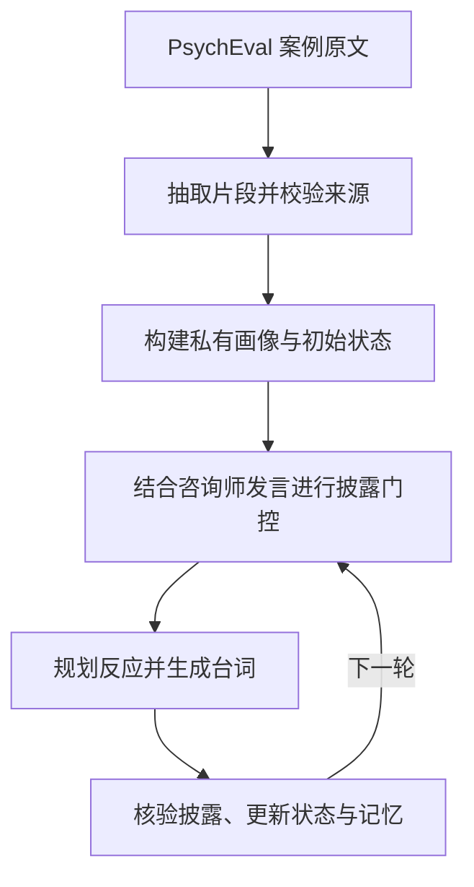

## 1. 当前结论

当前来访者由四部分共同构成：

1. **有来源的私有画像**：由 PsychEval 案例编译得到；
2. **渐进披露机制**：决定本轮哪些事实可以进入回答；
3. **互动状态与行为策略**：模拟情绪、信任、阻抗、疲劳及关系破裂；
4. **受限语言生成器**：只依据已说过内容和本轮获准事实生成台词。

本地 processed 数据包含 **341 个案例**：BT 43、CBT 148、HET 50、PDT 50、PMT 50。当前尚不能宣称已实现经过验证的五大人格模型、学习型情绪动力学或 EFT 来访者/咨询师。

## 2. 来访者是怎样构建的

### 2.1 离线画像构建

PsychEval 原始 `client_info` 被编译为`ClientProfile`：

| 画像层 | 内容 | 作用 |
|---|---|---|
| 基础资料 | 年龄、职业、主诉、咨询目标等 | 保持人物与问题一致 |
| `EvidenceNode` | 原文片段、来源路径、字符位置、流派 | 追溯每条信息的来源 |
| `DisclosureItem` | 原子事实、激活词、信任档位、依赖、会谈范围 | 控制何时可披露 |
| `FivePsFormulation` | 主诉、易感、诱发、维持、保护因素 | 跨流派的证据投影 |
| `InteractionPrior` | 应对、情绪接近、误解风险 | 指导互动反应，不作为诊断 |
| `ClientExpressionStyle` | 有来源的语言、互动和情感表达风格 | 约束说话方式 |
| `ClientState` | valence、arousal、distress、trust、resistance、hope、fatigue、rupture | 表示可审计的仿真状态 |

自由文本通过抽取模型做**逐字 span 切分**；程序重新定位并校验原文位置。失败时保留原文并标记 `needs_review`，不允许模型补写案例事实。当前缓存共记录 3100 个抽取项，其中 116 项为 fallback/待复核项。

### 2.2 每轮来访者生成

具体顺序如下：

1. **披露门控**：用咨询师本轮话语匹配事实激活词，再检查会谈范围、事实依赖和信任档位；同类候选无法区分时要求咨询师具体化。
2. **内部规划**：规划器可读完整私有画像，但只输出反应、强度、行为、阻抗类型、信任变化和获准事实 ID，不直接生成台词。
3. **语言生成**：生成器看不到完整私有画像，只能看到表达风格、当前状态、近期对话、已说过的记忆、本轮获准事实，以及不含正文的 blocked 话题信号。
4. **纵深防护**：系统核对台词是否真正表达了声明的事实，并检查是否提前泄漏；失败后最多修复一次，仍失败则使用安全替代回答。
5. **状态与记忆更新**：只有实际说出口且能找到文本证据的内容才进入 `UnlockedClientInfo`，供咨询师和后续会谈使用。

### 2.3 状态变化

当前有七个 0–1 数值变量：情绪效价、唤醒度、痛苦、信任、阻抗、希望和疲劳；关系破裂另用离散状态表示。模型判断互动反应，程序按固定系数更新数值。跨会谈保留部分信任变化、恢复疲劳，并将阻抗和关系破裂重置为初始值。

这套机制具有可解释、可回放的优点，但参数目前是工程启发式设置，**不是临床量表，也不是已经训练或验证的情绪动力学模型**。

## 3. 与其他智能体的关系

- **咨询师**不直接接收完整私有画像，但仍接收案例计划目标与会后记忆；这些内容可能间接携带尚未披露的信息。
- **多流派适配**保留 BT、CBT、HET、PDT、PMT 各自的案例字段、技能树、阶段和指标；不能把 HET 或 PMT 改名当作 EFT。
- **会后记忆**从实际对话提取、合并并生成摘要。合并模型会接触全局画像，代码对部分字段限制回填，但尚未对全部嵌套内容逐条核验。
- **督导师**在完整多会谈轨迹结束后评分一次；可选 RFT 在同一会谈的完整候选之间评分选优。两者目前都不直接更新模型权重。

## 4. 已完成与未完成

| 能力 | 状态 | 说明 |
|---|---|---|
| 有来源的来访者画像 | 已实现 | 原文证据、原子事实、5Ps 和流派信息可追溯 |
| 渐进披露与信息隔离 | 已建立机制，待完整审计 | 已有规划/台词分离；计划、规划说明和记忆链路仍需检查 |
| 多轮及跨会谈状态 | 已实现（工程模型） | 支持信任、阻抗、情绪和疲劳变化 |
| 五大人格 | 未实现 | `BigFive` 仅为遗留类型，当前不生成、不参与运行 |
| 情绪动力学 | 部分实现 | 有状态转移，但尚非数据学习或临床验证模型 |
| EFT 独立适配器 | 未实现 | 需独立案例、技能树、阶段和评估标准 |
| 来访者多样性验证 | 未完成 | 尚需真实模型实验与人工评审 |
| 自进化训练闭环 | 未完成 | 已有候选选优、经验/技能生命周期和导出接口，尚无自动训练与上线 |

## 5. 接下来的工作和目标

### 近期：把当前来访者基线验证清楚

- 复核缓存清单记录的 116 个待复核抽取项；审计计划、规划说明和记忆链路，建立泄漏、虚构、过早披露及机械阻抗测试集。
- 使用真实 API 完成多案例、多随机重复实验。

### 中期：实现可验证的人格与情绪建模

- 将五大人格定义为**独立、可解释、可校准**的行为条件变量，不从案例 ID 随机生成，也不把人格分数当作案例事实。
- 建立状态转移模型：`状态(t+1)=状态(t)+咨询行为影响+个体差异+受控随机扰动`，用标注轨迹拟合并检验稳定性、敏感性和跨会谈一致性。
- 逐项控制人格、问题情境和流派条件，检验行为可区分性与案例一致性，再按预算扩展组合实验。
- 建设独立 EFT 案例、技能库、治疗阶段和评价指标，经专家复核后再接入运行时。

### 长期：形成“咨询—督导—反馈—进化”闭环

- 将安全合格的完整会谈进入经验池，生成同一上下文下的 chosen/rejected 轨迹。
- 先开展监督微调/模仿学习，再分别研究偏好优化与强化学习；拒绝采样仅用于数据筛选。按案例隔离训练和测试，固定来访者评测版本，检验咨询师增益能否迁移到未见案例。
- 督导反馈先作用于下一会谈计划和技能候选，再通过回放、专家审核、离线评测和回滚门槛决定是否更新技能或模型。
- 最终实现：多样化来访者 + 多流派咨询师（含独立 EFT）+ 督导师的多智能体沙盒，并形成“经验积累—策略优化—能力提升”的可审计自进化系统。

### 最终验收目标

系统不仅要“能生成对话”，还应同时满足：**案例事实不越界、人格与情绪变化可解释、不同流派可区分、跨会谈行为连续、督导反馈确实改善独立测试集表现、任何更新可审核且可回滚**。

实验同时记录失败率、调用成本和评审一致性，避免将咨询师适应模拟器偏差误判为能力提升。
